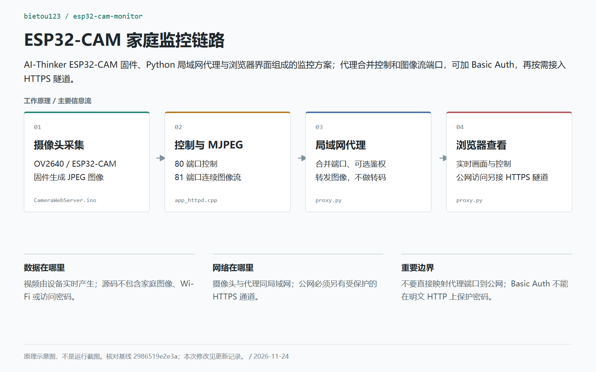

# ESP32-CAM 家庭监控

<!-- project-guide:start -->
## 图文原理导览

AI-Thinker ESP32-CAM 固件、Python 局域网代理与浏览器界面组成的监控方案；代理合并控制和图像流端口，可加 Basic Auth，再按需接入 HTTPS 隧道。



**主链路：** 摄像头采集 -> 控制与 MJPEG -> 局域网代理 -> 浏览器查看。

**数据与边界：** 视频由设备实时产生；源码不包含家庭图像、Wi-Fi 或访问密码。 摄像头与代理同局域网；公网必须另有受保护的 HTTPS 通道。

[完整图文说明、源码入口与运行步骤](docs/PROJECT_GUIDE.md)

<!-- project-guide:end -->

把一块 AI-Thinker ESP32-CAM 变成一个可在外网查看的家用摄像头：摄像头固件 + 局域网反向代理 + 手机友好的 Web 界面，配套可选的状态灯与自动重连。

## 架构

```
手机/浏览器 ──HTTPS──> 公网隧道（cloudflared / frp / Tailscale）
                          │
                          └──> 局域网服务器:8090（proxy/proxy.py，可选 Basic Auth）
                                  │
                                  ├─ 80 口 Web UI / 控制接口
                                  └─ 81 口 MJPEG 流
                                        ↑
                                  ESP32-CAM（AI-Thinker）
```

摄像头本身不直接暴露到公网；代理负责合并 80/81 两个端口、加鉴权和移动端界面。

## 硬件

- AI-Thinker ESP32-CAM（带 PSRAM，OV2640 常见）
- USB-TTL 烧录器（无自动下载电路时接 GPIO0 到 GND 进下载模式）
- 5 V 电源（摄像头 + Wi-Fi 峰值电流较大，USB 供电不足会反复重启）

## 固件

1. 复制配置模板并填写 Wi-Fi：

   ```bash
   cd CameraWebServer
   cp config.example.h config.h
   ```

   `config.h` 已在 `.gitignore` 中，不会被提交。需要固定 IP 时取消 `USE_STATIC_IP` 相关行的注释。

2. 用 Arduino CLI 编译烧录：

   ```bash
   arduino-cli compile --fqbn esp32:esp32:esp32cam CameraWebServer
   arduino-cli upload  --fqbn esp32:esp32:esp32cam -p COM5 CameraWebServer
   ```

   也可以在 Arduino IDE 里选开发板「AI Thinker ESP32-CAM」后直接上传。

3. 串口 115200 会打印拿到的 IP。固件特性：

   - 连接 Wi-Fi 时用补光灯 LED（GPIO4）闪烁提示，连上后熄灭并交还给摄像头补光
   - 断网后每 5 秒重连；约 20 秒连不上自动重启
   - 摄像头 Web UI 在 80 口，MJPEG 流在 `:81/stream`

常用接口：`/capture` 单帧、`/control?var=framesize&val=8`（VGA）、`/control?var=quality&val=12`、`/status`、`/control?var=led_intensity&val=255`（补光灯，仅推流时亮）。

## 反向代理

`proxy/proxy.py` 只依赖 Python 3 标准库，配置全部走环境变量：

| 变量 | 默认 | 说明 |
|------|------|------|
| `CAM_HOST` | 192.168.1.50 | 摄像头地址 |
| `CAM_HTTP_PORT` | 80 | 摄像头控制端口 |
| `CAM_STREAM_PORT` | 81 | MJPEG 流端口 |
| `CAM_AUTH_USER` / `CAM_AUTH_PASS` | 空 | 两项都设置才启用 Basic Auth |
| `LISTEN_PORT` | 8090 | 代理监听端口 |
| `LISTEN_HOST` | `::` | `::` 为 IPv6 双栈，`0.0.0.0` 仅 IPv4 |

本地试跑：

```bash
cd proxy
CAM_HOST=192.168.1.50 CAM_AUTH_USER=cam CAM_AUTH_PASS=secret python proxy.py
```

部署到局域网服务器（只依赖 paramiko）：

```bash
pip install paramiko
NAS_HOST=192.168.1.10 NAS_USER=admin NAS_PASSWORD=*** \
  TEST_USER=cam TEST_PASS=secret python proxy/deploy.py
```

也可以手动部署：参考 `proxy/cam-proxy.service` 与 `proxy/cam-proxy.env.example`，放到 `/etc/systemd/system/` 和 `/etc/` 后 `systemctl enable --now cam-proxy`。

界面功能：实时画面、补光灯开关、拍照下载、画质切换（流畅 QVGA / 标准 VGA / 高清 XGA）、全屏。断流自动重连。

## 公网访问

任选一种，**不要把 8090 直接端口映射到公网**：

- **cloudflared quick tunnel**：零配置，但每次都换 URL，且免费线路可能绕境外中转，延迟高
- **cloudflared 命名隧道**：固定域名，需要 Cloudflare 托管域名
- **frp / Tailscale / WireGuard**：自有服务器或组网方案，延迟取决于线路

无论哪种，都要先设置 `CAM_AUTH_USER` / `CAM_AUTH_PASS`，并只通过 HTTPS 访问；Basic Auth 在明文 HTTP 下等同于没有密码。

## 已知限制

- 免费 quick tunnel 的中转节点可能在境外，画面延迟明显；降低分辨率与画质（QVGA + quality 16）可缓解
- 部分网络对 `*.trycloudflare.com` 有 DNS 污染
- 摄像头与代理需要同一局域网；代理不做转码，分辨率由固件端设置决定
- 补光灯和状态灯共用 GPIO4：推流时补光灯亮，非推流时可能被状态闪烁覆盖

## 许可

本仓库原创部分（固件修改、代理、部署脚本、文档）使用 MIT，见 [LICENSE](LICENSE)。

`CameraWebServer/` 下的 `app_httpd.cpp`、`camera_index.h`、`camera_pins.h` 来自 Espressif 的 ESP32-CAM 示例，使用 Apache License 2.0，见 [NOTICE](NOTICE)。
