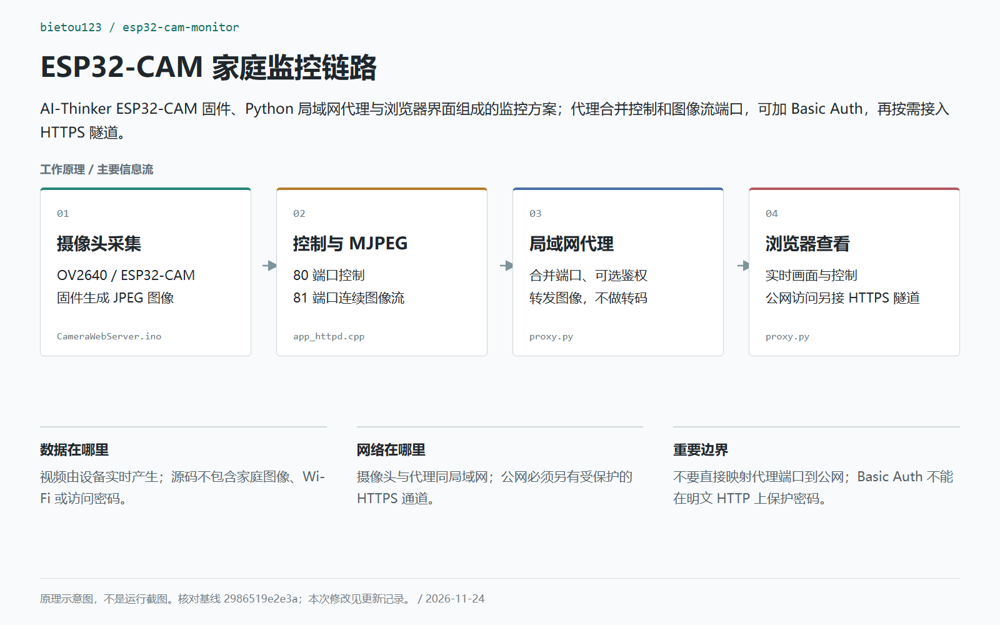
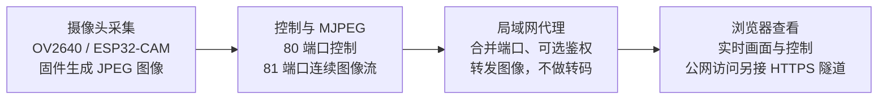

# ESP32-CAM 家庭监控链路

AI-Thinker ESP32-CAM 固件、Python 局域网代理与浏览器界面组成的监控方案；代理合并控制和图像流端口，可加 Basic Auth，再按需接入 HTTPS 隧道。

**适合谁：** 想搭建自用摄像头，并理解摄像、代理、鉴权与公网隧道各自职责的硬件爱好者。

## 一图看懂

上图是依据公开源码绘制的原理示意，不是运行截图；以下表格与文字提供相同信息，便于小屏阅读。

## 主链路与源码

| 步骤 | 做了什么 | 代码或说明入口 |
| --- | --- | --- |
| 1. 摄像头采集 | OV2640 / ESP32-CAM；固件生成 JPEG 图像 | [CameraWebServer/CameraWebServer.ino](../CameraWebServer/CameraWebServer.ino) |
| 2. 控制与 MJPEG | 80 端口控制；81 端口连续图像流 | [CameraWebServer/app_httpd.cpp](../CameraWebServer/app_httpd.cpp) |
| 3. 局域网代理 | 合并端口、可选鉴权；转发图像，不做转码 | [proxy/proxy.py](../proxy/proxy.py) |
| 4. 浏览器查看 | 实时画面与控制；公网访问另接 HTTPS 隧道 | [proxy/proxy.py](../proxy/proxy.py) |

## 关键原理

### MJPEG 不是编码后的视频文件

固件通过 multipart 连续发送 JPEG 帧，浏览器的图像元素显示这条流。分辨率与 JPEG 质量由摄像头控制接口设置，Python 代理只转发，不把它转换成 H.264 或 MP4。

对应入口：[CameraWebServer/app_httpd.cpp](../CameraWebServer/app_httpd.cpp)。

### 代理承担访问边界

浏览器只连接代理，代理按路由请求摄像头控制端口或流端口。只有用户名、密码两项均设置才启用 Basic Auth；未设置时仍可运行，但不能当作安全的公网摄像头。

对应入口：[proxy/proxy.py](../proxy/proxy.py)。

### 隧道与固定入口不同

HTTPS 隧道提供对代理的远程通道，quick tunnel 的地址会变化。cam 仓库是可选的固定跳转入口；它既不传输摄像帧，也不替代代理端的密码验证。

对应入口：[README.md](../README.md)。

## 数据与安全边界

| 范围 | 说明 |
| --- | --- |
| 数据 | 视频由设备实时产生；源码不包含家庭图像、Wi-Fi 或访问密码。 |
| 网络 | 摄像头与代理同局域网；公网必须另有受保护的 HTTPS 通道。 |
| 重要边界 | 不要直接映射代理端口到公网；Basic Auth 不能在明文 HTTP 上保护密码。 |

## 运行与复现

先从 config.example.h 创建自己的 config.h，再按主 README 编译固件。代理配置使用环境变量；本次文档整理不连接摄像头、不烧录设备。

本次为图文原理整理，没有执行设备动作、系统切换或付费请求。已有验收范围与运行条件以主 README 和相关报告为准。

## 已知限制

- 供电、Wi-Fi、代理与隧道任何一层不稳定都会造成断流。
- 免费隧道的线路和延迟不可控，代理不负责转码或录制。

## 本次更新

2026-11-24：新增项目专属原理图、源码入口、运行条件与边界说明。本项目本轮没有修改功能，也没有扩大既有实测结论。

## 可编辑流程图

下面的 Mermaid 与上方 PNG 表达同一主链路，便于后续维护：

[返回项目 README](../README.md)

源码核对基线：[2986519e2e3a](https://github.com/bietou123/esp32-cam-monitor/tree/2986519e2e3a21d882ba838fee5049c10ce818b0)，并结合本次更新中列明的改动。
